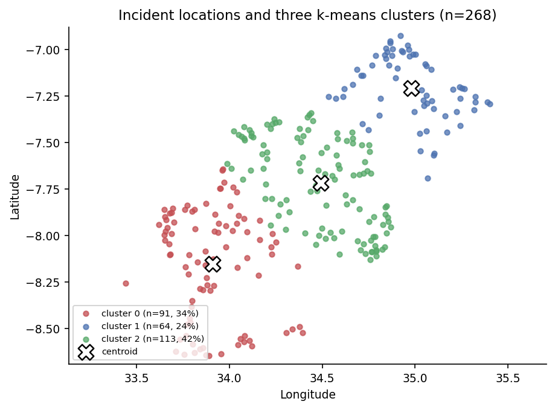

# Reported poaching incidents in Tanzania (2005-2015)

A small, reproducible spatial analysis of 268 georeferenced poaching incident reports from
Tanzania: where the reports cluster, how dense they are, and how much the dates in the dataset
can actually be trusted.



## Problem / research question

Two questions:

1. **Where** are the 268 reported poaching incidents concentrated?
2. **How much can the dates tell us?** The dataset ships with two date columns (incident date
   and report-created date) - do they behave the way the documentation says?

## Dataset source and usage permissions

| | |
|---|---|
| File | `data/poaching_points_cleaned.csv` (268 rows x 6 columns, 24 KB) |
| Columns | `id_report`, `date_report`, `created_date`, `description`, `lat`, `lon` |
| Original source | `poaching_points_cleaned.csv` from **The Data Visualization Workshop** (Packt), `github.com/PacktWorkshops/The-Data-Visualization-Workshop`, folder `Datasets/` |
| This copy | the unchanged course copy provided for CISC7204 (University of Macau), 2026 |

The file contains **no personal data**: an incident id, two dates, the constant text
`Poaching incident`, and a latitude/longitude pair. It is a small educational sample published
with the book's public repository and is reused here for educational, non-commercial purposes
with attribution. If you reuse it, cite the book repository above.

## Methods and tools

- **pandas** - load, type conversion, duplicate / missing / range checks, derived columns
- **scikit-learn** - `KMeans(n_clusters=3, n_init=10, random_state=0)` on the raw lon/lat, so
  the grouping is reproducible
- **matplotlib** - four figures, written to `images/` at 150 dpi
- **hexbin** - a cluster-count-free density view, used as a cross-check on k-means
- Python 3.10, pinned in `requirements.txt`

## Key findings

- **Spatial concentration.** The largest of three clusters holds **113 of 268 reports (42.2%)**,
  centred near **34.49 E, 7.72 S**; the other two hold 34.0% and 23.9%. The busiest hexbin cell
  contains 6 reports, which matches the same hotspot pattern without imposing a cluster count.
- **Records, not a trend.** Recorded incidents peak in **2012 (46)** and drop to **2 in 2014**;
  2015 covers January-September only, so the yearly bars describe when reports were written
  rather than a clean trend.
- **The date dictionary does not hold.** In **62.3% of rows `created_date` is earlier than
  `date_report`**, which is impossible if the two columns mean "report created" and "incident
  happened". Incident dates are also reused: **2012-07-14 appears 9 times**. That is why this
  notebook does not build a seasonality story from the month of the incident date.
- **One limitation.** There is no denominator - no patrol effort, no protected-area size, no
  population at risk. These are **268 reports**, so the clusters show *where incidents were
  reported*, not where poaching is worst.

| Figure | File |
|---|---|
| Recorded incidents per year | `images/incidents_per_year.png` |
| `created_date - date_report` distribution | `images/report_lag_distribution.png` |
| Locations and three k-means clusters | `images/incident_clusters.png` |
| Hexbin density | `images/incident_density_hexbin.png` |
| Clusters split by date quality (robustness check) | `images/cluster_robustness.png` |

### Robustness check (added after a peer review)

A classmate's review of the first version raised the obvious risk: 62.3% of the rows have
suspicious dates, so maybe the hotspot is simply built out of those rows. Splitting the 268
reports by date quality and keeping the same three clusters:

| rows | n | in the largest cluster | share |
|---|---:|---:|---:|
| all | 268 | 113 | 42.2% |
| date-consistent (`created_date >= date_report`) | 101 | 46 | 45.5% |
| date-inconsistent | 167 | 67 | 40.1% |

The hotspot holds in both subsets (40.1% to 45.5% against 42.2% overall), so it is not an
artefact of the bad dates - the two findings support each other instead of competing. The figure
is `images/cluster_robustness.png`: filled markers are the date-consistent rows, open markers the
inconsistent ones, and the counts are annotated next to each centroid.

## How to run

```bash
# 1) environment (Python 3.10)
python -m venv .venv
# Windows: .venv\Scripts\activate      macOS/Linux: source .venv/bin/activate
pip install -r requirements.txt

# 2) run the analysis
jupyter notebook poaching_hotspots.ipynb
# Kernel -> Restart & Run All; the four figures are rewritten into images/
```

Headless equivalent:

```bash
jupyter nbconvert --to notebook --execute --inplace poaching_hotspots.ipynb
```

Everything is deterministic: the k-means seed is fixed and the CSV is committed, so a fresh
run reproduces the numbers above.

## Repository layout

```
data-science-project/
  poaching_hotspots.ipynb     executed notebook (question -> checks -> figures -> summary)
  data/poaching_points_cleaned.csv
  images/                     4 figures used by this README and the portfolio page
  requirements.txt
  README.md
```

## Author

HE SHIHAO - University of Macau, CISC7204 Data Science and Data Visualization.
